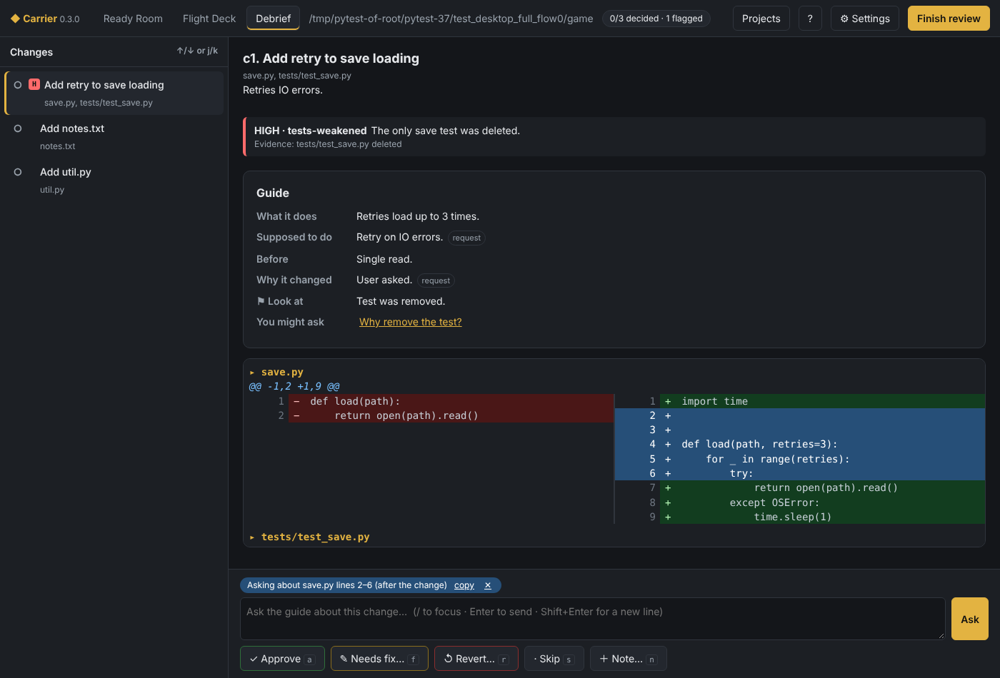

# Carrier

**Brief. Launch. Debrief.**

A mothership for Claude Code: launch AI agents in parallel, keep them aware
of each other, and review every change they bring home.

Carrier is a desktop app (plus a terminal version) for Windows, macOS and
Linux. It wraps your own Claude Code in three tools:

| | Tool | What it does |
|---|---|---|
| 📋 | **Ready Room** | Brief each project: its goal, rules, task queue, folders and presets |
| 🚀 | **Flight Deck** | Launch Claude Code on tasks — several sessions at once, each aware of what the others are changing |
| 🔍 | **Debrief** | Review every change when it comes back, with an AI guide that explains what changed and why. You decide; fixes go back as the next task |

## Quick start

You need [Git](https://git-scm.com/downloads),
[Python 3.11+](https://www.python.org/downloads/) and
[Claude Code](https://claude.com/claude-code) (installed and signed in).
Carrier uses your Claude Code sign-in — no API key.

**Windows:** double-click `Carrier.bat`  
**macOS / Linux:** run `./carrier.sh`

The first start sets everything up (about a minute). Then:

1. **Ready Room → ＋ New project** — pick a folder, write a goal and a first task.
2. **Flight Deck → ▶ Start** — guide Claude as it works, then **✓ Mark done**.
3. **Debrief → Start review** — approve each change, or send it back for fixing.

> Linux needs GTK WebKit for the window:
> `sudo apt install python3-gi gir1.2-webkit2-4.1`

## Highlights

- **Parallel sessions that don't collide.** Carrier tracks every edit and
  warns Claude (or asks you) before two sessions touch the same file, and
  can give a session its own git worktree.
- **Reviews that know why.** Debrief links each change to what you asked for
  and which task made it, groups edits into logical changes, and has review
  agents flag what deserves a closer look.
- **You set the thoroughness.** Choose the model and effort for each session
  and each review agent — Opus at high effort for a security check on
  sensitive code, Sonnet at low effort for a throwaway tool.
- **✨ Draft with Claude.** Describe your rules or a review agent in plain
  words; Claude writes it up for you to edit and save.
- **Bring your existing work.** Point Carrier at a folder you've used with
  plain Claude Code or the Claude app; Claude reads its history and helps you
  turn it into one project or several — in place, or reorganised.
- **Organised work.** Task groups that run in parallel, routines (update the
  docs after each task, push once everything is reviewed) with an optional
  review gate, and a full history of every change to a task.
- **Safety nets.** A local secrets scan before anything is published, alerts
  when Claude needs you, and a backup of your data before every upgrade.
- **Private by default.** No network code in Carrier itself, no open ports,
  read-only review agents. Only Claude Code talks to the internet.
- **Accessible.** Colour-blind-safe themes, high contrast and monochrome,
  full keyboard control.

## Learn more

- **[The full guide](docs/GUIDE.md)** — every feature, setting and command
- [Architecture](ARCHITECTURE.md) — how it's built
- [Contributing](CONTRIBUTING.md) — setting up a development copy
- [Changelog](CHANGELOG.md)

## Status

Alpha — usable day to day, still changing. Bug reports and ideas are
welcome in Issues.

**Tested on Windows 11**, which is where Carrier is used day to day. It is
built to run on macOS and Linux too, and the automated tests run there, but
those platforms haven't been tried by hand yet — reports are very welcome.

## License

Carrier is free software under the **GNU Affero General Public License
v3.0** ([AGPL-3.0](LICENSE)). You may use, study, share and change it; if you
distribute a modified version, or let people use one over a network, you
must share its source under the same license.
