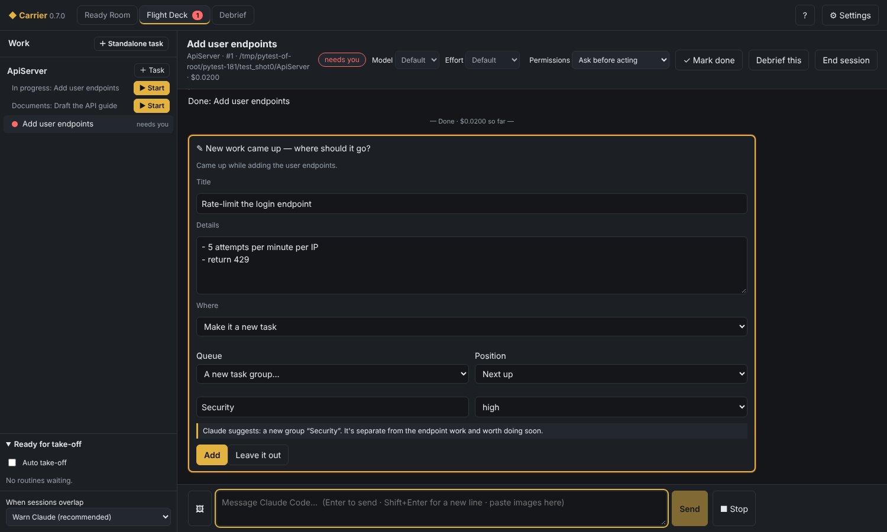
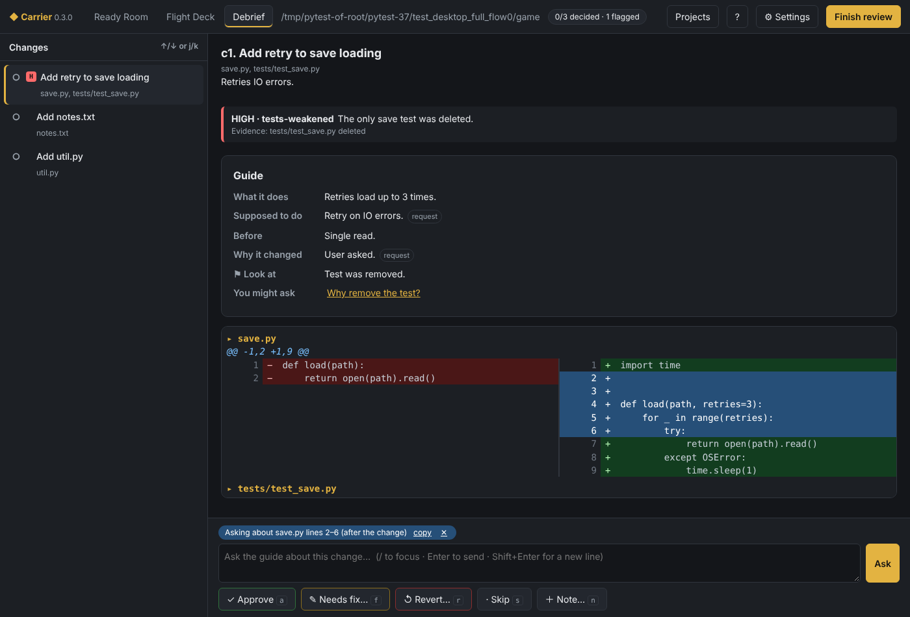

# Carrier — the full guide

**Carrier** — *Brief. Launch. Debrief.*

A mothership for Claude Code: launch AI agents in parallel, keep them aware
of each other, and review every change they bring home.

This is the complete guide. For a quick start, see the [README](../README.md).

## Contents

1. [How Carrier fits together](#how-carrier-fits-together)
2. [Getting started](#getting-started)
3. [Ready Room — setting projects up](#ready-room--setting-projects-up)
4. [Project folders](#project-folders)
5. [Importing existing work](#importing-existing-work)
6. [Flight Deck — launching work](#flight-deck--launching-work)
7. [Debrief — reviewing what came back](#debrief--reviewing-what-came-back)
8. [Review agents](#review-agents)
9. [Models and effort](#models-and-effort)
10. [Draft with Claude](#draft-with-claude)
11. [Terminal and command line](#terminal-and-command-line)
12. [Accessibility](#accessibility)
13. [Privacy and security](#privacy-and-security)
14. [Files Carrier writes](#files-carrier-writes)
15. [Building a standalone app](#building-a-standalone-app)
16. [Troubleshooting](#troubleshooting)
17. [Planned features and known issues](#planned-features-and-known-issues)

---

## How Carrier fits together

Carrier wraps your own Claude Code in three tools, one for each stage of a
mission:

| Tool | Stage | What it does |
|---|---|---|
| **Ready Room** | Brief | Set up each project: what it is (its long-term goal), the rules Claude follows, a queue of tasks, its folders, presets and review agents |
| **Flight Deck** | Launch | Run Claude Code on a project's current task. Several sessions run at once, and sessions in related projects are kept aware of each other |
| **Debrief** | Debrief | Review what changed since the last review, one change at a time, with an AI guide that explains each change and why it was made |

Work flows in a loop: the Ready Room hands **tasks** to Flight Deck, Flight
Deck's sessions produce **changes**, and Debrief reviews them. Anything you
send back for fixing becomes the project's **next task**.

All three share one local database of projects, tasks and edits, so each
tool knows what the others did.

---

## Getting started

### Requirements

* [Git](https://git-scm.com/downloads)
* [Python 3.11+](https://www.python.org/downloads/)
* [Claude Code](https://claude.com/claude-code), installed and signed in
  (run `claude` once)

Carrier uses your Claude Code sign-in, settings and `CLAUDE.md` files — no
API key. Claude Code itself is not bundled.

### Start the app

| Platform | Desktop app | Terminal version |
|---|---|---|
| Windows | Double-click `Carrier.bat` | Drag a project folder onto `Carrier Terminal.bat` |
| macOS, Linux | `./carrier.sh` | `carrier debrief` |

* **First run** creates a private Python environment in `.venv` and installs
  Carrier into it (about a minute). Later starts are immediate.
* **Setup checks** on the Ready Room's start page confirm that Git, Claude
  Code and the Agent SDK are found, with a hint for anything missing.
* **Opening tab:** the Ready Room until you have a project, then Flight Deck.

> **Linux** needs GTK WebKit for the window:
> `sudo apt install python3-gi gir1.2-webkit2-4.1` (Debian/Ubuntu),
> or use Qt: `.venv/bin/pip install "pywebview[qt]"`.

### Your first mission

1. **Ready Room → ＋ New project.** Choose the project's folder, write a
   short long-term goal and a starting task — or press **✨ Draft with
   Claude…**, describe the project in your own words, and let Claude fill in
   the form.
2. **Flight Deck → ▶ Start** next to the task. Guide Claude as it works;
   press **✓ Mark done** when it's finished.
3. **Debrief →** pick the project, **Start review**, and go through the
   changes: approve them, or send them back for fixing.

---

## Ready Room — setting projects up

The Ready Room is where each project is set up before work starts. Click
**＋ New project**, choose its main folder, and give it a long-term goal and
a starting task; everything else can be added later.

### What a project holds

| Part | What it is | Sent to Claude? |
|---|---|---|
| Long-term goal | What the project is, in a few sentences | Yes |
| Task queue | The tasks to do. The first one is the **current task**, the one Flight Deck works on next | The current task |
| History | Finished tasks with a short summary of what was done | The last few |
| Rules | Instructions for this project, added to the global rules | Yes |
| Rule sets | Reusable bundles of rules attached to the project | Yes |
| Folders | The main folder plus extra work or reference folders ([Project folders](#project-folders)) | Their names and paths |
| Links | Related projects and the files they share | Used for coordination |
| Default preset | The session settings used when a task starts | No |
| Tags | Labels for finding projects in a long list | No — they're only for you |

### Managing tasks

* Reorder with ↑ and ↓, or **Make current** to move a task to the top. Edit
  or delete any task that isn't in progress.
* Add a task at the end, or tick **make it current** to put it next. A task
  already in progress stays current.
* Finished tasks move to **History** with their summary. **Reopen** puts one
  back in the queue.

### Shared settings

The sidebar holds settings shared by all projects:

* **Global rules** apply to every session in every project, and to
  standalone tasks.
* **Rule sets** are named bundles of rules you can attach to projects,
  presets, templates or the global rules.
* **Session presets** save a model, effort level, permission mode, overlap
  setting and an optional rule set.
* **Project templates** are starting points for new projects. **Save as
  template** on a project makes one from it.
* **Review agents** set up Debrief's reviewers ([Review agents](#review-agents)).

### Task groups

A **task group** is a separate queue inside a project that runs alongside the
main one — for example *Documents*, so drafting docs never holds up code work.
Each group has its own current task; Flight Deck shows it under the project
with its own **▶ Start**, and sessions from different groups are aware of each
other's edits just like sessions in linked projects.

* Make one with **＋ New task group** in the Tasks card: a name, a priority —
  High, Normal, Low, or **Backlog** for ideas with no priority yet — and tags
  (just for you).
* Add a task to a group with the queue selector next to *Add task*, or move
  one with its **Move to…** menu. Deleting a group moves its tasks to the
  main queue.
* Backlog groups never start anything on their own.

### Pre-approved actions

On the project page, **Pre-approved actions** are what the project's
sessions may do without asking you — the permission cards Flight Deck
would otherwise show:

| Option | Covers |
|---|---|
| Read files | Reading and searching inside the project's folders (work, reference and workspace) |
| Create and edit files | Writing and editing inside the session's folder and the work folders — except `.git`, `.claude`, `.carrier`, `.mcp.json`, `.gitmodules`, `.vscode`, `.idea`, `.husky`, `.devcontainer` and `.envrc`, which can make git, Claude Code or your editor run commands, so they always ask |
| Search the web | Web searches |
| Fetch web pages | Any site, or only the sites you list (a site includes its subdomains) |
| Programs | Groups you tick (below) and programs you list, in shell commands |
| Other tools | Exact tool names, for example a connected tool such as `mcp__github__get_issue` |

**Programs.** A shell command runs without asking when *every* program in
it is pre-approved — pipes, `&&`, variables and all. For example, with
`javap` and `awk` pre-approved this runs straight away:

```
JP="/c/Program Files/Java/jdk-17/bin/javap.exe"; "$JP" -c -cp lib.jar Foo | awk '/private/'
```

Carrier reads the command without running it, and asks whenever it can't
be sure. It follows variables set in the same command, knows that
`javap.exe` in an install folder (`Program Files`, `/usr`, the PATH …) is
`javap`, and lets `2>&1` and `> /dev/null` through. Writing output to a
file counts as an edit (allowed in the work folders if editing is
pre-approved). It still asks for: `$( )` and backticks, here-documents,
loops, `if` and `{ }`; a program from a variable it can't see, or an
unquoted variable the shell would split; settings that change how programs
behave (`PATH=`, `JAVA_HOME=`, `GIT_…`, `LD_PRELOAD`, `VAR=x program` …);
`cd` out of the project's folders; and a program file somewhere unusual
(it offers that exact file instead, for example the game's own Java).

Groups (one tick each): **Java (JDK)** `java javac javap jar jdeps`,
**Gradle**, **Maven**, **Node.js**, **Python**, **.NET**, **Rust**, **Go**,
**Git (looking only)** `git status`, `git diff`, `git log` …, **Read-only
helpers** `grep head tail wc sort cat ls` … (files outside the project's
folders still ask), and **Text processing** `awk sed` (separate, because
`awk` can run other programs; `sed` is allowed only for printing,
deleting and substituting lines). Groups that fit the folder are marked
*suggested*.

In **More programs** you can list a program (`javap`), a script in the
project by its path (`./build.sh`, `bash build.sh`), or a program with its
first arguments (`git status` allows `git status -s` but not `git push`).
Programs whose job is running other commands — `bash`, `sh`, `cmd`,
`powershell`, `env`, `xargs`, `sudo` … — can't be pre-approved on their own:
that would allow any command. Options that make a listed program run other
code or touch other files still ask (`git -c`, `git config`,
`git diff --output`, `find -exec`, `find -delete`, `sort -o`, `sed -i` …).
Pre-approving a build tool or runtime lets Claude run code it wrote; that's
usually the point, but it's worth knowing.

**Claude is told the list.** Each session's instructions include a short
*Permissions in this project* section, generated from these settings: what
runs without asking, what still asks (`$( )`, loops, `PATH=` …), and to work
accordingly — use the Read, Grep, Glob and Edit tools for files, keep shell
commands to one job with literal paths (a tool's full path rather than
looking it up with `$( )`), and only ask for more when the task needs it or
it saves many steps, saying why in one line. If you change the settings while
a session runs, Claude is told with your next message. It's guidance: what
actually runs without asking is still decided by Carrier's checks.

Everything else still asks. Files outside the project's folders always ask,
edits in reference folders stay blocked, and Claude Code's own settings and
the session's **Permissions** setting still apply. A permission card shows
which programs in a command are pre-approved (✓) and which aren't, and can
add the missing ones with **Always allow … in this project** (or **for this
session**); when something else makes it ask, the card says what.
Templates copy the list, and changes appear in the activity log.

**Also let Claude Code use these outside Carrier** (on by default) writes
the list into the project's `.claude/settings.local.json` as Claude Code
rules (`Bash(javap:*)`, `Read(/**)` …), so Claude Code in the terminal or
the Claude app doesn't ask for them either. Reading and editing are shared
for the main folder only, with edits to `.git`, `.claude` and the like
still asking there too. Read-only helpers, Git (looking only), text
processing and other programs whose options Carrier holds back (`find`,
`sort` …) aren't shared at all: Claude Code's own rules couldn't keep them
to the project or stop those options. Carrier changes only the rules it wrote — yours
stay — and makes git ignore the file on this computer
(`.git/info/exclude`), like Claude Code does. Inside Carrier, Carrier's own
list decides.

### Images, activity log and secrets

* **Images:** a project switch allows or blocks pictures in its sessions.
  Pictures you paste, and pictures Claude shows or opens, are sent to
  Anthropic as part of the conversation, like your messages; with the switch
  off, sessions are text only and Claude can't open image files.
* **Activity log** (on the project page) lists everything recorded for the
  project, newest first: every task change, and changes to its goal, rules,
  rule sets, folders, task groups, routines and skills, the images switch and
  pre-approved actions,
  rules and skills Claude suggested that you added, and finished reviews.
* **Secrets:** the Routines card warns about likely secrets in the project's
  files (keys, tokens, passwords, private keys) and about key or `.env` files
  git would publish. Remove a secret, or **Mark safe** a line that isn't one
  (any change to it is reported again); **Add secret-file patterns to
  .gitignore** fixes the files. Routines that need a clear review wait while
  a likely secret is there. Flight Deck also warns before sending a message
  that looks like it contains a key. The checks run on your computer, with
  patterns — no AI, nothing sent. A "Secrets and credentials" review agent is
  available too (off by default, as *Security-sensitive* covers most of it).
* **Starting review history:** a project whose work predates Carrier can
  **Start review history from now** (Routines card), so reviews and the review
  gate look only at new work.

### Tidying tasks with Claude

When the queues have grown — overlapping tasks, one task per finding, stale
ideas — press **💬 Tidy tasks with Claude…** on the Tasks card. The
project's queues are on the left, the conversation on the right. Claude
looks over the queues and suggests changes one topic at a time; the tasks
it talks about are highlighted. Each suggestion is a card:

| Card | What it does |
|---|---|
| Merge tasks | Pulls tasks into one (the merged ones are closed as merged; their details are kept in it) |
| Move to another queue | Moves tasks to the main queue, a group, or a new group |
| Re-order a queue | Puts a queue's tasks in a new order |
| Split a task | Moves part of a task out into a new one |
| Reword a task | A clearer title or details |
| Drop tasks | Closes tasks that aren't needed any more — they stay in the history with the reason |

**Apply** a card (untick tasks you want to keep out, or edit its text) or
**Skip** it; reply in the box to steer. Nothing changes without your OK, and
every change is in the tasks' history as made by Claude with your approval.
Tasks being worked on can't be merged, split or dropped. **Start over**
forgets the conversation (not the changes).

### Task history

Every change to a task is recorded: created, edited, scope added, work
pulled in or moved out, split, moved between queues, finished, reopened,
deleted — when, by whom (you, Claude with your approval, a routine or a
review), and why. **Changes** on a task shows it; text that left a task is
listed under *Removed from the task*, so anything descoped by accident is
easy to spot. Debrief's agents get the tasks worked on since the last review
as they finally read, with these changes, and are told to treat removed work
as something that shouldn't silently go missing.

### Routines

A **routine** is a task a project runs again and again. Set them up in the
project's **Routines** card: a name, what Claude should do, when it runs, and
whether it needs a clear review.

| When | What happens |
|---|---|
| When I press Run | **▶ Run** puts it next in the task queue |
| After each task is finished | It queues itself as the next task whenever another task is marked done |
| When its task group is finished | It queues itself when the last open task of its group is done |

A routine can be tied to a **task group**: it then goes into that group's
queue, and "after each task" reacts only to that group's tasks. Each routine
has its own **permission mode** — ask before acting, auto-accept edits, or
plan only — and routines never run with "Never ask", whatever the project's
default preset is.

**Ready for take-off** (in Flight Deck's sidebar) lists every queued routine,
with whether it's waiting for a clear review. Turn on **Auto take-off** to
start them automatically as soon as their gate is clear — each one is a
normal Flight Deck session using its project's default preset. Backlog groups
are left alone.

| Review gate | Meaning |
|---|---|
| None | It can start any time |
| Only when the review is clear | Flight Deck won't start it while a review is open in Debrief, any work folder has changes since its last review, or a fix task from a review is still open — it says which |

For example, "Update the documentation" after each task, and "Push to
GitHub" when the review is clear. **Pause** stops an after-each-task routine
from queueing itself. Routine tasks are marked *routine* in the queue.

### Skills

**Skills** (in the sidebar) lists the Claude Code skills of a project — kept
in `.claude/skills` in its main folder — and your personal skills, which
apply everywhere. Open one to edit it, or **＋ New skill**: give it a name, a
sentence saying when to use it (Claude Code decides from that sentence), and
the instructions. **✨ Draft with Claude** writes one from a description.
Flight Deck sessions load these skills, as Claude Code does in a terminal.

### Finding and checking projects

* Search by name and filter by tag from the sidebar.
* **Linked projects:** link projects that affect each other and name the
  files they share, as patterns. For example, an API server and a web client
  that share a JSON schema: `schema/**/*.json` on the server side,
  `src/api-client/**` on the client side. Flight Deck uses these links to
  keep their sessions aware of each other; a project with no links is never
  interrupted by the others.
* **Tasks across projects.** Sessions of linked projects are told about
  each other: the note, the shared files, and that they may **propose work
  for the other project** (you approve it; it goes in that project's queue).
  Such tasks are **linked**: a task shows *⇢ Opened Editor #31* or *⇠ Opened
  from Mod #12*, and a click opens the other project at that task. A task can
  **wait on** another one (*⏸ Waiting on Editor #31*): auto take-off leaves it
  alone until that task is done, and its history notes when it can go ahead.
  The task's session is told about its links. Debrief can hand work over too:
  **Make a task … in** a linked project, in the health report and in the
  walk-through.
* **What Claude will be told…** shows the exact text added to Claude Code's
  instructions for the project: goal, current task, rules and recent history.
  Your `CLAUDE.md` files still load as usual.

---

## Project folders

Every project has one **main folder**, where Claude Code runs, and can have
extra folders of two kinds.

| Folder | Claude can | Reviewed by Debrief | Shared with other projects |
|---|---|---|---|
| Main folder | Read and edit | Yes | Only as a reference folder — each main folder belongs to one project |
| Work folder (this project's) | Read and edit | Yes | No |
| Work folder (shared space) | Read; edit its part and new files freely, anything else only after asking you | Its part, files it created there, files its sessions changed | Yes, as a work folder of each |
| Reference folder | Read only; edits are blocked | No | Yes |
| Workspace folder | Read only, except new folders it creates there — those join the project as work folders | Only the new folders, as work folders | Yes |

* Add extra folders with **＋ work folder**, **＋ reference folder** or
  **＋ workspace folder**, and switch a folder's type later from its card.
* **Workspace folders** suit a shared parent such as a modding workspace that
  holds several projects. The project can read everything there but change
  nothing that exists; when its work needs a new folder outside the main
  folder — a release tool, a publish folder — Claude creates it there and
  Carrier adds it to the project as a work folder (a notice says so). A
  workspace folder may contain the project's main folder.

### Who owns what

* **A main folder is its project's alone.** Another project can use it (or
  anything inside it) only as a *reference folder*: read, never edited. Adding
  it as a work folder offers a reference folder instead. Projects set up
  before this rule are fixed when Carrier starts: such a work folder becomes a
  reference folder, and the project's log says so.
* **Another project's main folder inside a work folder** (a workspace-like
  folder holding several projects) stays that project's: edits there are
  blocked, and Debrief leaves it out. The folder's card says *holds …'s main
  folder (read only)*.
* **This project's work folder:** everything in it is the project's.
* **Shared space:** a work folder other projects work in too. Carrier marks a
  work folder as shared as soon as a second project adds it, and it stays
  shared while they both do. In a shared space the project owns **its part**:

  | What | How it's set |
  |---|---|
  | Files matching its patterns | **Part…** on the folder's card, one pattern per line: `ships` or `ships/**` (a folder and everything in it), `data/ship_*.csv`, `*.md` (that name in any folder) |
  | Files it created there | Automatic: a new file a session creates in the shared space becomes the project's |
  | Files its sessions changed | Counted for reviews only |

  **Editing outside its part always asks you**, even when editing is
  pre-approved for the project and even in Claude Code's "accept edits" mode:
  the permission card says the file is outside this project's part, and has
  no "for this session" button — each such edit asks. In "never ask" mode
  these edits are blocked instead, and Claude tells you what it needed.
  Shell commands that change files there (`cp`, `mv`, `rm`, `tee`, `touch`,
  `git checkout`, a `>` redirect …) ask too. Claude is told which part is
  its own.
* **Reviews of a shared space** cover only the project's part, the files it
  created there and the files its sessions changed; the rest is left out and
  the review says how many. A change another project's Flight Deck session
  made is marked as that project's work (the item shows *task (Animation)*),
  and the agents are told not to judge it against this project's requests.
* Each work folder's card also has **Leave out of reviews** (Debrief neither
  reviews nor scans it) and **Note…**, which tells the review agents what the
  folder is, for example *"Animation's export folder; only ships/ is ours"*.
  They see it with every change in that folder.
* **Separate reviews:** each project keeps its own record of where its last
  review ended, so reviewing one project never marks the other's changes as
  reviewed.
* **File names:** files in an extra folder are named `<folder name>/<path>`
  everywhere — in Flight Deck, in shared-file patterns and in reviews. If the
  name clashes with a top-level item in the main folder, Carrier adds a
  number, such as `lib-2`.
* **Git:** a main or work folder can be a whole git repository or a folder
  inside a bigger one; then Debrief reviews only that folder (this is how one
  workspace can hold several projects). A folder not in git yet is fine too:
  Debrief offers to start tracking it. Reference folders can be anywhere.

---

## Importing existing work

Already working on something with plain Claude Code or the Claude app?
**Ready Room → Import existing work** turns that folder into one Carrier
project, or splits it into several, without losing what you've done.

1. **Choose the folder.** Optionally add a **claude.ai data export** (the
   .zip from claude.ai *Settings → Privacy → Export data*) so Claude can use
   your chats about this work.
2. **Look at it.** Carrier reads — and changes nothing — the folder layout,
   README files, every CLAUDE.md, the permissions in `.claude` settings (never
   their environment values), the recent git history, and the Claude Code
   sessions that ran there. From an export it ticks the chats that mention
   the folder or its parts; untick or tick others.
3. **Choose how to organise it:**
   * **In place** — nothing moves. Each project uses existing folders, for
     example `mods/Animation` as one project's main folder and
     `tools/editor` as another's, while the workspace stays one git
     repository. A workspace-wide CLAUDE.md keeps applying, because Claude
     Code reads CLAUDE.md files from the main folder's parent folders too.
   * **Reorganise** — Claude may propose moving folders into a cleaner
     layout. You approve each move.
   * **Decide with Claude** — Claude recommends one.
4. **Talk it through.** Claude says what it found — the separate strands of
   work, what you kept asking for, what looks unfinished or abandoned — and
   proposes projects. Answer its questions, or ask for changes ("put the
   demo mod in the animation project", "drop the scratch folder").
   Claude asks its questions as clickable option cards, like in a session.
   If you state a lasting rule along the way, it appears as a rule card: edit
   it and add it to a project in the plan or to one of the plan's rule sets.
5. **Edit the plan.** Every project's name, main folder, goal, rules, rule
   sets, tags, extra folders and tasks can be edited on the page; Claude
   builds on your edits when you send your next message. **Check the plan**
   lists anything that can't work (a missing folder, two projects with the
   same main folder, …).
6. **Create projects.** Carrier makes the rule sets, projects, folders and
   tasks. With moves, it moves the folders first (git keeps their history;
   untracked and ignored files move with them). If anything fails, what was
   made is removed and the moves are undone.

If the folder has no git history yet, Carrier offers to **start it here**: a
first commit of the workspace as it is, after adding suggested lines to
`.gitignore` (build output, caches, downloads and key files found there —
edit them first).

By default the current state counts as **already reviewed**, so each new
project's first Debrief review shows only work done from now on. Untick
*Treat the current state as already reviewed* to review everything.

An unfinished import is saved, so you can close the app and pick it up from
the Import page later. Claude gets no tools while importing: it sees only
the summary Carrier gives it and can't read or change files itself.

**Good to know**

* Moving folders breaks links that point into them from elsewhere
  (shortcuts, symlinks, Windows junctions) and paths written in scripts or
  CLAUDE.md. Claude adds a task to fix those when it proposes moves.
* Projects in one repository each keep their own Debrief checkpoints and
  reviews. Flight Deck's **own copy** of such a project copies the whole
  repository and runs in the project's folder inside the copy.
* Your old Claude Code conversations stay where they are; resume them with
  `claude --resume` in that folder.

---

## Flight Deck — launching work

Flight Deck runs your normal Claude Code inside the Carrier window — the same
tools, `CLAUDE.md` files and settings, with a chat view instead of a
terminal. Work is always a task: a project's current task, or a standalone
task.



### Starting work

* **▶ Start** next to a project runs its current task. **＋ Task** picks a
  different open task or adds a new one.
* **The start dialog** chooses the task, a session preset, and optionally a
  model and effort for this session only. It can also send the task as
  Claude's first message.
* **Several sessions** can run at once, in different projects or the same
  one. When a folder already has a session, the dialog offers a choice:
  **share the folder** (Carrier warns about overlapping edits) or an **own
  copy** — a git worktree on a new branch, so the two can't clash; you merge
  it later.

### Working with a session

* **Chat:** Claude's replies, its thinking and each tool it uses appear as
  they happen. Type to guide it at any point.
* **Permissions:** prompts appear as buttons — **Allow**, **Allow for this
  session**, **Always allow … in this project** (adds it to the project's
  [pre-approved actions](#pre-approved-actions)),
  or **Deny** with a reason. The header's **Permissions** setting
  can also be *Ask before acting*, *Auto-accept edits*, *Plan only (no
  changes)*, or *Never ask* (which needs confirming).
* **Questions:** when Claude needs you to choose, its questions appear as a
  card of options (one or several per question, with a recommended one
  first). Click your answers — or type your own — and **Send answers**, or
  **Skip** to let Claude carry on with its best judgement.
* **Suggested rules:** when you say something that should hold for future
  work ("never…", "always…", "from now on…"), Claude suggests it as a rule.
  The card lets you edit the wording and choose where it goes — this
  project's rules, your global rules, an existing rule set, or a new rule set
  attached to the project — then **Add rule** or **Dismiss**. Nothing is
  saved until you add it; new sessions use it.
* **Images:** paste a screenshot into the message box, drop one on the chat,
  or use 🖼. Click a picture before sending to draw on it (pen, box, arrow)
  and add a note for Claude. Claude can show you pictures too — a screenshot
  it took or a diagram it drew — and images it opens appear in the chat.
  Click any picture to see it full size.
* **Suggested skills:** when Claude works out a procedure worth reusing, or
  you ask for one, it suggests a skill. Edit the name, when-to-use sentence
  and instructions, then save it to the project or to your personal skills.
* **Other projects:** Claude can read your other projects' setup — goal,
  rules, rule sets, folders, open tasks and skills — for example "look at how
  Read Aloud is set up for releases and suggest rules for this project". It
  then suggests rules and skills for you to approve; it never changes the
  other project.
* **New work that comes up:** when something outside the task turns up,
  Claude doesn't just do it or drop it. It reads the project's queues and
  routines and asks where it belongs, with a suggestion: add it to the
  current task, or make it a new task in the main queue, an existing task
  group or a new group — and where in that queue (next, at the end, or after
  a given task). Edit the title and details, pick the place, then **Add**, or
  **Leave it out**. Claude waits for your answer and only does the work now
  if you added it to the current task.
* **Changing tasks to match the work:** if this task turns out to need work
  planned in another task, Claude asks to **pull it in** (whole — the other
  task is closed as merged — or just a part), or to **split** part of this
  task out into a new one. You can edit every text before **Change the
  tasks**, so the record matches what was actually done.
* **Alerts:** when a session needs you, the Flight Deck tab shows a pulsing
  badge, the other tabs show a banner with **Go there**, the session and its
  waiting card pulse gently, and (in ⚙ Settings → Alerts) the taskbar button
  can flash and a short chime can play. **Do not disturb** keeps just the
  badge. A dot on the tab means a routine is ready for take-off.
* **Own copies:** when a session that worked in its own copy ends, **Bring it
  back…** merges its branch into the main folder (if there are conflicts,
  nothing changes and you're told where), lets you review it first, keeps
  only the branch, or discards it. The project page lists copies not brought
  back yet.
* **Model and effort** can be changed in the header while Claude is waiting
  for you. A new model applies from the next message; a new effort reconnects
  the session and continues the same conversation.
* **Stop** interrupts Claude mid-reply.
* **⏸ Pause** puts the session to sleep when you switch focus: Claude Code
  disconnects, the task stays with this session, and other sessions stop
  treating it as active (no overlap warnings about it, no briefings that it's
  at work). **Resume** carries on the same conversation, and with your next
  message Claude is told every file that changed in its folders while it
  slept — by another session (named), by you or by anything else — and to
  re-read those before relying on them. Closing Carrier pauses open sessions
  the same way.
* **One session per task.** While a task has a session (working or paused),
  its button reads **Open** instead of **▶ Start**: finish or end that one
  before starting another. Big tasks are better split into smaller ones.
* **End session** finishes with the conversation for good — it can't be
  resumed (it stays in the list, read only, for a day). The dialog asks for a
  **note for the next session on this task**: what's done, what's left, what
  to watch out for. Write it yourself, or press **✨ Claude writes the note,
  then end**. The next session that starts the task gets the note with its
  task; you can edit or remove it in the Ready Room (**Edit note** on the
  task).
* **Cost** for the session is shown in the header.

### Usage and limits

The **Usage** button at the top of every tab shows how close you are to
Claude's usage limits, for example *5h 62% · Week 30%*. It turns amber near a
limit and red when one is reached. Click it for the full picture:

* **Limits** (subscriptions — Pro and Max): each window Claude Code reports —
  the 5-hour limit, the weekly limit and any per-model weekly limits — with
  how much is used, when it resets and the tokens used in that window.
  Claude Code reports limits only while an agent runs, so each shows how old
  its figures are; once a reset time passes, the window shows as reset.
* **Tokens:** today, the last 7 days, Flight Deck sessions against the rest of
  your Claude Code use (the terminal, the Claude app's Code tab, Debrief's
  reviews and drafts), a 14-day chart, and the top projects, tasks and models.
  Hover any figure for input, output and cache tokens.
* **Cost:** what the same use costs at API list prices. With an API key that
  is real money (each Flight Deck session also shows its exact cost); on a
  subscription it is only a comparison. Models older than the 5 series show
  tokens without a cost.

Token counts come from the logs Claude Code keeps in `~/.claude/projects`,
so they include work done outside Carrier. Carrier reads them read only and
keeps only the numbers (time, model, folder, conversation id, tokens), for 60
days — never what was said. You can turn this off.

**When a limit is reached** in the middle of a task, Claude Code stops.
Carrier doesn't treat that as a failure: the session shows *usage limit —
until 15:40*, nothing starts on its own, and when the limit resets Carrier
tells Claude to carry on where it stopped. This works across a restart of
Carrier too. **Continue now** carries on straight away (useful if you have
extra usage turned on), and typing a message works as usual. If Claude Code
doesn't say when the limit resets, Carrier tries again after 10 minutes, then
20, 40 and every hour. Starting work by hand while a limit is reached asks
first.

**Before a limit** (⚙ Settings → Usage and limits):

| Setting | Default | What it does |
|---|---|---|
| How you pay for Claude | Detect it | Subscription shows limits; API key puts cost first |
| Warn me at | 80% | A banner (and the alerts you chose) when a limit gets this full |
| Hold automatic starts at | 90% | The level for the next two settings |
| Hold auto take-off | on | Auto take-off waits; the take-off list says why |
| Ask before starting a routine | on | Starting a routine by hand asks first |
| Continue after the reset | on | Off: the session waits for you to press **Continue now** |
| Count tokens from Claude Code's logs | on | Off: no token counts, limits still work |

Claude Code may only report a percentage near a limit; until then a window
can show as *ok* without a figure. A per-model weekly limit (for example Opus) only
warns: Claude Code carries on with another model, so nothing is held for it.
With an API key, the same waiting applies to API rate limits.

### Finishing a task

| Button | The task | The session | What's kept |
|---|---|---|---|
| **✓ Mark done** | Done; the next one in the queue becomes current | Stays open | A short summary (by Claude or you) in the project's history |
| **⏸ Pause** | Stays with the session | Asleep; **Resume** carries on | The conversation, plus what changed while it slept |
| **End session** | Back to the queue (unless done) | Over for good | A note for the next session on the task |
| **Debrief this** | Unchanged | Unchanged | — opens a review of exactly what the session changed |

### Standalone tasks

**＋ Standalone task** runs a one-off task with no project, in a folder you
choose or a scratch folder Carrier makes. Afterwards:

* **Make it a project** turns its folder into a new project.
* **Add to a project** records the task in a project's history and can queue
  an *"Integrate this work"* task saying where the files are. Files are
  never moved.

### Keeping sessions aware of each other

1. **Automatic tracking.** Every file a session edits is recorded — Claude
   doesn't have to report anything.
2. **Before an edit:** if another live session changed the same file, or the
   file is shared with a linked project, the overlap setting decides what
   happens:

   | Overlap setting | What happens |
   |---|---|
   | Warn Claude (default) | Claude is told before the edit and can adjust |
   | Ask me first | You approve or deny the edit |
   | Block the edit | The edit is refused and Claude is told why |
   | Only show it | A notice in Carrier; Claude isn't told |

   The setting is global (bottom of the sidebar); a session preset can
   override it.
3. **When you send a message:** Claude gets a short briefing of what related
   sessions did since your last message, for example *"api-server session #1
   changed the shared contract file schema/user.json — check whether this
   project needs a matching update."* You see exactly what was shared.
4. **Reference folders, watched.** For a project that builds on another
   project's files — a ship editor that reads an animation project's
   formats — turn on **Keep sessions up to date with the reference folders**
   on its Ready Room page. With each message, Claude is told which files
   changed in the project's reference and workspace folders since the last
   one (by another session, by you, or anything else), and the page shows a
   notice as soon as another session edits one. After a pause they're part of
   the catch-up too. The project's switch is the default; each reference or
   workspace folder's card has its own **Keep sessions up to date** to turn
   it on or off for that folder (**Use the project's switch** goes back).
5. **Work for a linked project.** When a session's work changes something a
   linked project relies on (above all the shared files), or needs something
   from it, Claude proposes a task **for that project**: the card says which
   project, offers its queues, and can mark this session's task as **waiting**
   for it. Nothing is added until you press **Add**. See *Tasks across
   projects*.

---

## Debrief — reviewing what came back

Debrief is a guided review of what changed in a project since its last
review: you make every decision, and an AI guide explains each change. It
reviews the main folder and all work folders together.



### Starting a review

1. **Pick the project.** Debrief lists its folders, with **Start tracking**
   for any that aren't in git yet.
2. **Choose what to review.** The default is everything since the last
   review. You can also choose only uncommitted changes, or everything since
   a chosen commit (main folder only).
3. Leave **Use AI agents** on for grouping, flags and explanations, or turn
   it off for a plain diff review.
4. **Start review.** **Cancel** stops preparing, and nothing is saved. A
   review in progress can be resumed later.

### Scanning the whole project

Some checks don't need history — a security check, or a custom agent that
looks for unexplained "magic numbers". **Scan the whole project instead**
(under *Start review*) checks every file in the project's folders as it is
now, with only the agents you tick (your choice is remembered per project).
Lock files, minified and very long files are left out. A scan is reviewed
like any other — approve, request fixes — but it doesn't change what counts
as reviewed, and it sits beside an open change review rather than replacing
it.

### Health checks

A review looks at what changed; a **health check** looks at the whole
project now and then — the kind of problems that build up slowly across many
changes. Open **Health check** below the review options. Each check looks at
the project's own files only: its main folder and work folders (not those
left out of reviews), without other projects' main folders, and in shared
spaces only the project's part. Lock files, generated, binary and very large
files are left out.

| Check | Theme | How it works | Due again |
|---|---|---|---|
| Security sweep | Safety | Reads the files | Every 14 days, changes or not |
| Rules compliance | Rules | Reads the files, against the project's and your global rules | Every 14 days, changes or not, and as soon as the rules change |
| Error handling and robustness | Reliability | Reads the files | 21 days after the last check, once the code changed |
| Tests | Reliability | Explores the project | 21 days, once the code changed |
| Cross-platform | Reliability | Reads the files | 30 days, once the code changed |
| Performance hotspots | Reliability | Reads the files | 30 days, once the code changed |
| Structure and boundaries | Design | Explores the project | 30 days, once the code changed |
| Duplication | Design | Explores the project | 30 days, once the code changed |
| Magic numbers and config | Design | Reads the files | 30 days, once the code changed |
| Dead code and leftovers | Upkeep | Explores the project | 30 days, once the code changed |
| Docs drift | Upkeep | Explores the project | 21 days, once the code changed |
| Dependencies and build | Upkeep | Explores the project | 30 days, once the code changed |

* **Nothing runs by itself.** A check shows as **Due** when it's worth running
  again, and the project list in Debrief says *health: N due*. Due checks are
  ticked; tick or untick any, then **Run selected checks**. **Cancel** stops
  a run; checks that finished keep their results.
* **Two kinds.** Checks that *read the files* go through them in parts, with
  line numbers. Checks that *explore the project* get the list of its files
  and read-only tools (Read, Grep, Glob) to search and read what matters —
  for questions about the whole, such as duplication or untested code.
* **Cost.** Each check shows a rough token count before you run it, and the
  total for the ticked ones.
* **Settings** are in the Ready Room, like review agents: **Health checks**
  in the Ready Room's menu for every project, or **Health checks for this
  project…** on a project's page (also linked from Debrief).
  * **All health checks** sets the model, effort, how serious findings are
    (*Flags as*) and the file budget for every built-in check at once — for
    example Opus for all of them. A check's own setting wins over it, and a
    project's settings win over those for every project.
  * Each built-in check can be switched off and given its own *Flags as*,
    model, effort, **Every … days** (how long until it's due again) and, for
    checks that read the files, a budget — **Read up to … KB**; over it, the
    most recently changed files go first and the rest wait for the next run.
  * **Your own checks:** **＋ New health check** (or **✨ Draft with Claude**)
    with a name, what to look for, its theme, whether it reads the files or
    explores the project, when it's due again, and its model and effort.
    Made in the Ready Room's menu, a check is for every project (a project can
    switch it off); made on a project's page, it's for that project only.
    Deleting one keeps its findings in the report, under *a deleted check*.
* **The health report** (**Open the health report**) works like a review:
  findings on the left, grouped by theme, most serious first; on the right
  the finding with **the code it's about** — the lines in question marked,
  with **More context** for more of the file — then what's wrong and what to
  do. **↑/↓** or **j/k** move between findings; **Esc** goes back. Each run is
  compared with the last: a finding is **new**, still **open**, or **not found
  again** (likely fixed).

  | Button | Key | What it does |
  |---|---|---|
  | Make a task | t | Adds it to the project's task queue in the Ready Room, with the details |
  | Accept | a | Keeps it as it is: it stays in the report but isn't counted, even when found again |
  | Dismiss | d | Not a real problem: hidden, even when found again |
  | Reopen | o | Counts an accepted or dismissed finding as open again |

  Deciding moves on to the next finding. **Show accepted, dismissed and not
  found again** lists the quiet ones too. With linked projects, **Make a task**
  has a choice of project: **in this project**, or in a linked one when the
  problem is theirs to fix.
* **💬 Walk through with Claude** (in the report) opens a conversation beside
  it. Claude groups the open findings — same cause, same area, or small
  things of similar priority — and goes through them group by group, most
  serious first; each finding it mentions is a link, and the report shows the
  one it's talking about with its code. It can read the project's files to
  check a finding, but changes nothing. For each group it proposes a card:
  **one task for these findings** (instead of one task each; in a linked
  project when it's theirs), **add them to an existing task**, **accept** or
  **dismiss** them. Untick findings to leave them out, edit the task's text,
  then **Apply** — or **Skip** and say what you'd rather do.
* **Failures.** If part of a check fails (a time-out, say), the findings in
  the files it couldn't read are kept as they were, the run is marked
  *incomplete*, and the check stays due. A check that fails doesn't stop the
  others. One health check runs at a time.
* **Tasks from findings** are marked as written by a health check, and their
  details tell Claude to verify the finding before acting on it — the text
  comes from an AI that read the project's files, so check it before you
  start the task.

### How a review is prepared

1. **Snapshot.** Each folder — including uncommitted and new files — is
   captured as a hidden git commit. Your branch, staged files and working
   files are not touched, and the review isn't affected if work continues.
2. **Context.** Debrief reads the project's goal, rules and notes
   (`CLAUDE.md`, `README.md`, `docs/`, `notes/`…) and your Claude Code
   session records, and links each edit to what you asked for at the time.
   Flight Deck's edit log tells it which task made each change.
3. **Grouping.** Related edits become one review item, such as "add input
   validation", rather than being shown file by file.
4. **Flags.** [Review agents](#review-agents) flag items worth a closer look.
   Flagged items are sorted high-severity first; nothing is hidden.

### What you see for each change

| Question | Where the answer comes from |
|---|---|
| What does it do? | The diff and surrounding code |
| What was it supposed to do? | Your request in the session, your project notes and goal |
| What was there before? | The original code |
| Why was it changed? | What you asked and what Claude said when it made the edit |

Every answer is labelled with its **source** — `request`, `claude`,
`notes:<file>`, `code`, `inferred` or `unknown`. When there is no record,
Debrief says so rather than inventing a reason.

### Reviewing

* **Items:** the list shows each item's decision, severity badge, title,
  files and the task that made it.
* **Diff:** unified, or side by side (old on the left, new on the right).
* **Ask the guide** what a change does, what was there before, or why it was
  made. Drag across lines in the diff to ask about exactly that code.
* **Decide:** **Approve**, **Approve, follow up later…**, **Needs fix…**
  (with a note), **Revert…** or **Skip**. You can also add a note to the
  project's notes, which future reviews read.
* **Approve, follow up later** is for something small: the change is
  approved — so the review can clear and routines waiting for a clear review
  (a push, say) can go on — and what you write goes into one *Review
  follow-ups* task at the end of the project's queue, an ordinary task that
  holds nothing. **Needs fix** is for what must be fixed first: its task holds
  those routines until it's done.

| Key | Action |
|---|---|
| `↓`/`j`, `↑`/`k` | Next / previous change |
| `a` `l` `f` `r` `s` | Approve · approve, follow up later · needs fix · revert · skip |
| `n` | Add a project note |
| `v` | Unified / side by side |
| `/` | Ask the guide |
| `Esc` | Clear highlight / close dialog |
| `?` | Help (desktop) · `t` theme, `F` finish (terminal) |

In the terminal, press `Tab` to move into the diff, then `Shift+↑/↓` (or drag
with the mouse) to highlight lines; `←`/`→` pick the side in split view.

### Finishing

**Finish review** writes a record of every decision to
`.carrier/reviews/<id>/record.md` and marks this point as reviewed in every
folder. Fixes and reverts become `fixes.md`. They're also added to the
project as its next task, *Fix review findings* — **Open in Flight Deck**
goes straight to it.

**Automatic preparation:** `carrier debrief init --hook` adds a Claude Code
*Stop hook*, so a review is prepared in the background each time Claude Code
finishes.

---

## Review agents

Review agents are the reviewers Debrief runs over each change. Each one looks
for one kind of problem and flags changes you should look at closely; none of
them can change files. They're managed in the Ready Room under **Review
agents**.

### Built-in agents

| Agent | Flags | Default severity |
|---|---|---|
| Drifts from the project notes | Changes that contradict the project's notes, goal or rules | High |
| Touches something hard to undo | Changes that are costly to get wrong or hard to reverse, such as public interfaces other code depends on | Medium |
| Unrequested changes | Edits beyond what you asked for | Medium |
| Security-sensitive | Secrets in code, and commands, SQL or file paths built from untrusted input | High |
| Hides errors | Errors caught and ignored, or turned into log messages without being handled | Medium |
| Tests removed or weakened | Tests deleted, skipped or made easier to pass | High |

### Settings for each agent

* **On or off** — switch any built-in off for every project, or just one.
* **Flags as** — how serious its findings are: high, medium or low. Flagged
  changes are sorted high first; an agent may still raise or lower the level
  for a particular change.
* **Model** — which Claude model runs it. A bigger model notices more and
  costs more.
* **Effort** — how hard the model thinks. More effort is more thorough,
  slower and costs more; an agent that browses the code may also look
  further.

Each setting is made once for all projects and can be changed for any one
project; a project shows the value it inherits. For example, run
*Security-sensitive* on Opus at high effort for a project that handles user
data, and on Sonnet at low effort for a throwaway tool.

### Your own agents

Add agents for every project or a single project. Each has a name, what to
look for, the three settings above, and options to read the project's notes,
see Claude's own explanations, or browse the code (read only). **✨ Draft with
Claude** can write the instructions from a short description.

Agents written as markdown files in a folder's `.carrier/criteria/` still
work too — see [writing-criteria.md](writing-criteria.md) and
[examples/criteria/](../examples/criteria/).

---

## Models and effort

Model and effort can be set for Flight Deck sessions and for each review
agent. Carrier gets the list of models from Claude Code itself.

* **Model list:** at startup Carrier asks Claude Code which models it offers
  and which effort levels each supports. It only connects and disconnects,
  so it costs nothing. The answer is saved for the next start.
* **Effort levels:** low, medium, high, extra high and max.
* **Your choice is kept.** If a model doesn't offer the level you chose, it
  runs at the closest lower level and a note says so ("runs at High"). If a
  model has no effort setting, the field is greyed out but still editable,
  and your choice applies again when you switch back.

| Place | Model | Effort | Applies to |
|---|---|---|---|
| Session preset | Yes | Yes | Every session started with the preset, or with a project that uses it by default |
| Start dialog | Yes | Yes | This session only; overrides the preset |
| Session header | Yes, from the next message | Yes, reconnects the same conversation | The running session, while Claude is waiting |
| Review agents | Yes | Yes | One agent, for every project or one project |

For a session, settings come from the first of: your choice in the start
dialog, the chosen preset, the project's default preset, then Claude Code's
own defaults.

---

## Draft with Claude

**✨ Draft with Claude** writes rules or a review agent from a description in
your own words; nothing is saved until you press Save. It appears next to
project rules, global rules, rule sets and a review agent's "What to look
for".

1. Describe what you want, for example *"no new libraries without asking;
   old saves must keep loading"*.
2. If the field already has text, choose whether Claude revises it or starts
   fresh.
3. **Write draft.** Edit the result freely, or **Write again**.
4. **Use this draft** puts it in the field. Review it there, then **Save**.

On **＋ New project** it fills in the whole form from your description:
name, long-term goal, project rules, a starting task with details, and tags.
If you've chosen the folder first, Claude also sees the folder's name, the
names of its top-level files and folders, and the start of its README —
nothing else from the folder — so the draft can match what's there. You then
**Create project**.

It's also next to **Tasks** (Claude writes a title and details — what to do
and what "done" means; you then **Add task**), **Routines** (name,
instructions, and a suggested trigger and review gate; you then **Save
routine**) and the **Skills** editor.

For project rules, the project's goal is given to Claude as context; for
tasks and routines, the goal and the tasks already queued. For
review agents, the draft also suggests a name and a severity. Each draft is
one short request to Claude with no tools, so it can't read or change files
(for a new project, Carrier itself passes along the folder glimpse above).

---

## Terminal and command line

Debrief also runs in the terminal, and every tool has commands for scripting
and quick checks. Run them inside a project's folder.

```bash
pip install -e .              # or: pipx install .
carrier                       # list the tools
carrier doctor                # check git, Claude Code and the Agent SDK
carrier app                   # open the desktop app
carrier debrief               # review since last time   (shortcut: debrief)
carrier debrief --from HEAD~5 # from a specific point
carrier debrief --no-ai       # walk the diff without any model calls
```

| Command | What it does |
|---|---|
| `carrier debrief prepare` / `list` | Prepare a review without opening it / print its items and flags |
| `carrier debrief status` / `checkpoint` | Show what's unreviewed / show or move the last-reviewed point |
| `carrier debrief fixes` / `criteria` | Show the latest fix list / list review agents |
| `carrier debrief init --hook` | Set Debrief up and add the Claude Code Stop hook |
| `carrier readyroom` | List projects, tags and current tasks |
| `carrier flightdeck status` | List projects, links and sessions |
| `carrier flightdeck add` / `link` / `unlink` / `remove` | Manage projects and links |

* In a project's main folder, terminal reviews cover the same folders,
  project context and review agents as the app, so a review can be started in
  one and resumed in the other.
* Ctrl+C cancels while a review is being prepared.
* Flight Deck sessions run in the desktop app only.

---

## Accessibility

Review colours can be switched for colour-vision deficiencies, and nothing
relies on colour alone: changed lines keep their `+`/`−` markers and severity
badges always show their name.

| Theme (⚙ Settings) | For |
|---|---|
| Default (red / green) | Typical colour vision |
| Red–green safe | Deuteranopia and protanopia |
| Blue–yellow safe | Tritanopia |
| High contrast | Low vision, bright screens |
| Monochrome | No colour at all |

* Removed lines in the colour-safe themes are also struck through, and any
  single colour can be changed with the colour picker. The theme applies in
  the terminal too.
* The review is fully usable from the keyboard; Esc closes dialogs.
* Text boxes underline misspelled words. On Windows, right-click a word for
  suggestions, plus undo, cut, copy, paste and select all.
* **Wide screens:** ⚙ Settings → Layout sets how wide the work area may
  grow — Normal (about 960 px), Wide (about a 16:9 screen), Wider, or the
  full window — and can centre it. This covers Ready Room pages and Flight
  Deck conversations; Debrief's diffs always use the full width.

---

## Privacy and security

Carrier keeps everything on your computer. The only thing that talks to the
internet is Claude Code itself, which sends your prompts to Anthropic as it
always does.

* **No network code.** Carrier's core makes no network connections, enforced
  by `tests/test_isolation.py`. The default *secure* build contains no
  networking code at all.
* **No open ports.** The app window opens no network port: the page is loaded
  straight into the window, talks to Python through an in-process bridge,
  and a Content-Security-Policy blocks all network requests.
* **Review agents and drafts can't change anything.** Debrief's agents get
  read-only tools; "Draft with Claude" and the import conversation get no
  tools at all. Debrief never
  edits your code — fixes go back to you as a task.
* **Flight Deck sessions are normal Claude Code:** they ask before acting
  unless you choose otherwise, exactly as in the terminal.
* **Model output is shown as text.** Claude's replies, file names and task
  text can never run as HTML or script in the app.
* **Projects only.** The window can only review your projects and Flight Deck
  sessions, not arbitrary folders.
* **Files Carrier writes in your projects.** With **Also let Claude Code use
  these** on, a project's pre-approvals go into its
  `.claude/settings.local.json` (only Carrier's own rules; yours are kept),
  and that file is added to `.git/info/exclude` so git won't publish it.
  Turn the switch off and Carrier takes its rules back out.
* **Usage counts are numbers only.** For token counts Carrier reads Claude
  Code's own logs, read only, and keeps just the time, model, folder,
  conversation id and token counts for 60 days — never the conversation.
  Turn it off in ⚙ Settings → Usage and limits.
* The planned **network edition** (access from other devices on your LAN)
  will live in a separate package that the standard build leaves out
  entirely — see [ARCHITECTURE.md](../ARCHITECTURE.md#editions-and-the-network-seam).

---

## Files Carrier writes

**In each project's main folder** (for a project inside a bigger
repository, in that repository's top folder):

```
.carrier/
  config.toml             project settings (optional)
  criteria/               review agents as markdown files (optional)
  notes.md                notes added during reviews
  reviews/<id>/           review.json, record.md, fixes.md
```

Git refs under `refs/carrier/` mark where the last review ended (one per
project) and keep review snapshots safe from `git gc`; your branches are
never touched.

**In your settings folder** — `%APPDATA%\Carrier` on Windows,
`~/Library/Application Support/Carrier` on macOS, `~/.config/carrier` on
Linux:

| File | Holds |
|---|---|
| `carrier.db` | Projects, tasks, rules, presets, templates, review agents, links, sessions and transcripts, health checks and their findings, and token counts (numbers only, 60 days) |
| `models.json` | The model list from Claude Code |
| `settings.json` | Theme, colours, overlap, alert, layout and usage settings |
| `desktop.log` | Errors and diagnostics from the desktop app |
| `worktrees/`, `scratch/` | Own-copy worktrees and standalone scratch folders |
| `backups/` | A copy of `carrier.db` taken before a new version upgrades it (the newest five are kept) |
| `imports/` | Unfinished imports (the conversation and plan); removed once the projects are created or the import is discarded |

---

## Building a standalone app

Builds a folder with `Carrier` (the app) and `carrier-cli` (terminal) that
runs without Python. Run it on each OS you want to ship for:

```bash
pip install -e ".[build]"
python packaging/build.py            # secure edition → dist/
```

On Windows, after `Carrier.bat` has run once, double-click
**`build-windows.bat`**. Claude Code isn't bundled (it's ~280 MB and you
already have it). `--bundle-claude` includes it for a personal build only —
Claude Code isn't open source and must not be in builds you publish. Each
build includes `LICENSE` and writes a `BUILD-INFO.txt` with the network
check result.

---

## Troubleshooting

Most problems leave a line in `desktop.log` in your settings folder — check
that first.

| Problem | What to do |
|---|---|
| Carrier won't start | Run `carrier doctor`, or check the setup checks on the Ready Room's start page |
| The window stops responding | Wait 20 seconds — Carrier writes what it was doing to `desktop.log`. Then close it (Windows: end `pythonw.exe` in Task Manager) |
| A project isn't in Debrief | Switch tabs to refresh. If it says *needs setup*, click it and **Start tracking** its folders |
| "Nothing to review" | Everything since the last review has been reviewed. Choose an earlier starting point to look again |
| A model rejects an effort level | Pick a lower effort or a bigger model |
| No right-click menu (Windows) | Check `desktop.log` for `[edit menu]` lines; `CARRIER_NO_EDIT_MENU=1` turns the menu off |
| The model list looks out of date | Restart Carrier; it asks Claude Code again at startup (`[models]` in the log) |

---

## Planned features and known issues

This section tracks what's coming and anything that doesn't work as it
should yet.

### Planned features

| Feature | What it adds |
|---|---|
| Local network access | Use Carrier from other devices on your network. An optional build that can be left out entirely |
| Right-click menu on macOS and Linux | Spelling suggestions and copy/paste in text boxes, as on Windows |

### Known issues

* Carrier is used and tested by hand on **Windows 11**; macOS and Linux run the
  automated tests but haven't been tried by hand yet.
* Questions only appear as option cards when Claude Code passes them to
  Carrier; if it doesn't, they appear in the chat to answer as a message.

Found something else? Please [open an issue](../../../issues).

### License

Carrier is licensed under the [GNU AGPL v3.0](../LICENSE). Use it, change it
and share it freely; if you distribute a modified version, or run one that
others use over a network, its source must be available to them under the
same license.

### Known limitations

* Reference folders block Claude's file-editing tools, and pre-approved
  commands that change files run without asking only inside the project's own
  folders; a command you approve by hand can still write anywhere.
* Flight Deck sessions run in the desktop app only, not in the terminal.
* The right-click spelling menu is Windows only.
* Some models may not accept every effort level; Carrier maps effort to what
  each model reports it supports.
